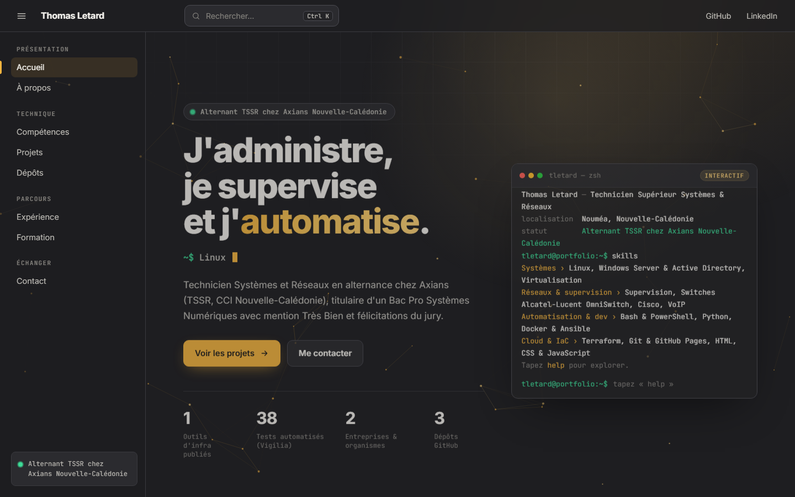
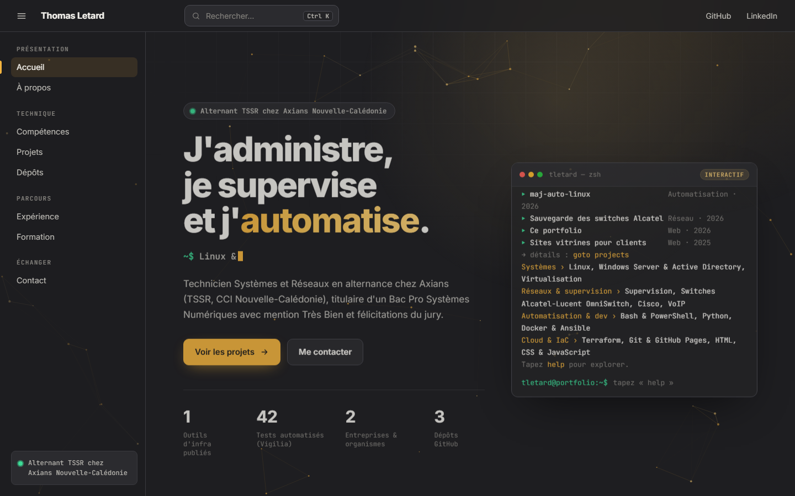
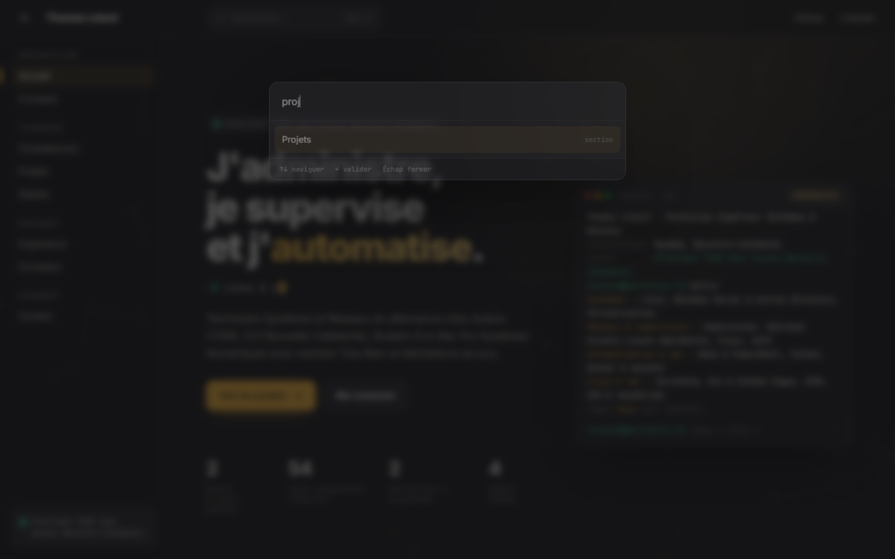
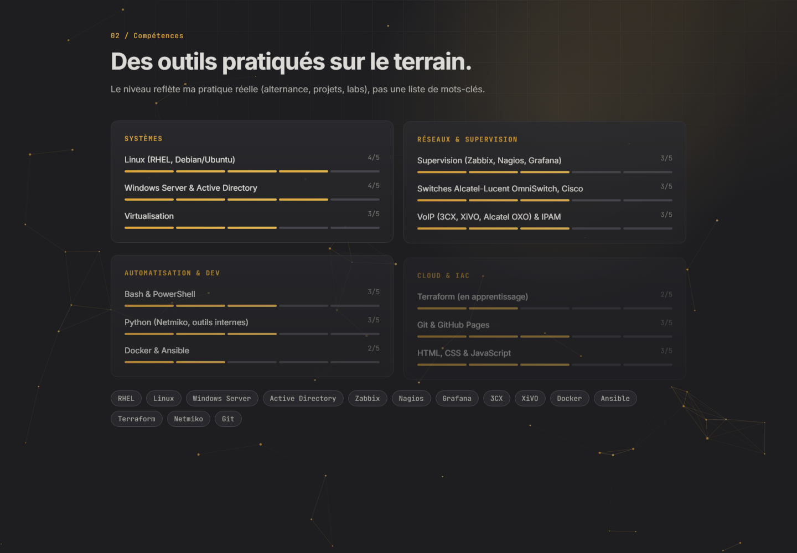
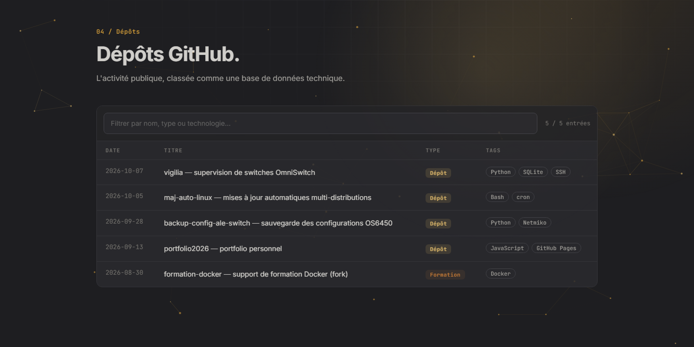
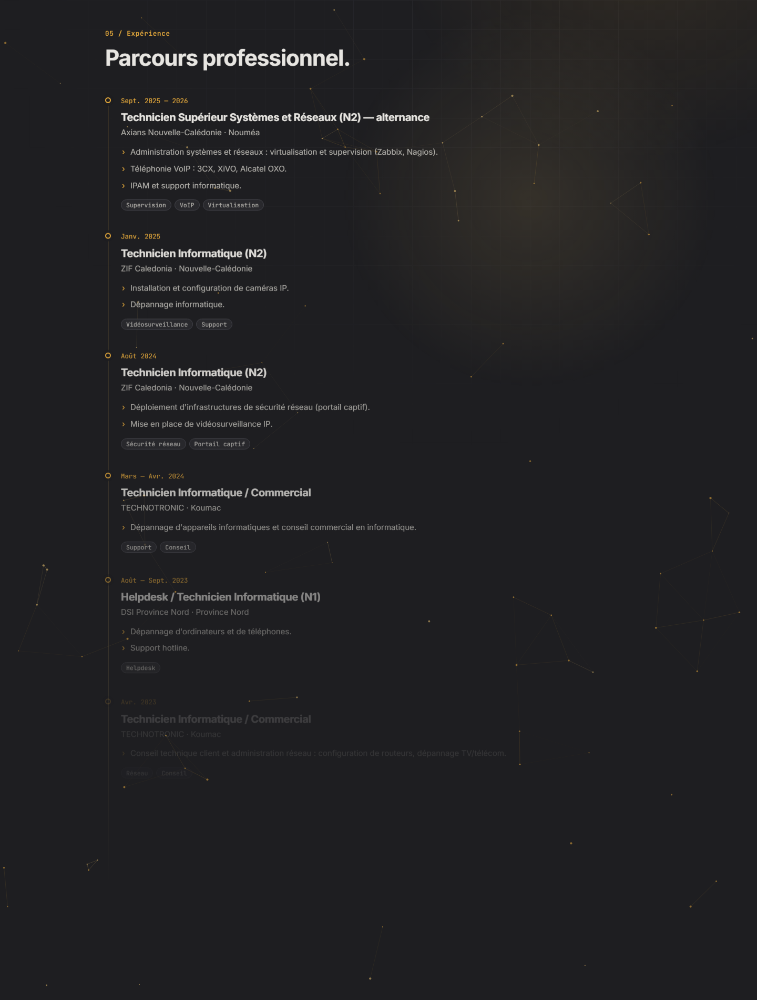
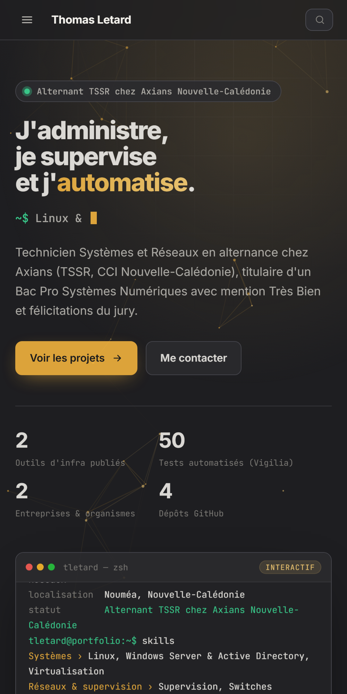
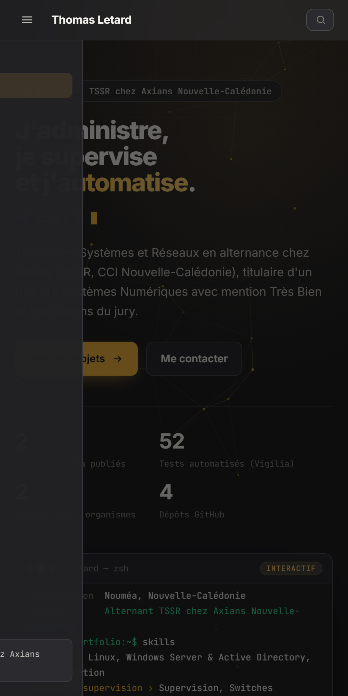

<p align="center">
  
</p>

# thomaswithlinux.github.io — *personal portfolio*


Personal portfolio of a **systems & network technician** (TSSR work-study,
Nouméa): career path, skills and infrastructure projects — supervision,
automation, Linux. **Static** site (native HTML, CSS and JavaScript), **no
framework and no build step**, hosted on GitHub Pages.

**Live: <https://thomaswithlinux.github.io/>**



> The screenshots in this repository are **generated automatically** by GitHub
> Actions (see [docs/screenshots](docs/screenshots/README.md)): they always
> reflect the published version.

## Table of contents

- [Features](#features)
- [Quick start](#quick-start)
- [Customizing the content](#customizing-the-content)
- [Tests and quality](#tests-and-quality)
- [Deployment](#deployment)
- [Documentation](#documentation)
- [Project structure](#project-structure)
- [Tech stack](#tech-stack)
- [Known limitations](#known-limitations)
- [License](#license)
- [Author](#author)

## Features

| | |
| --- | --- |
| **Boot screen** | Linux-style boot sequence, played once per session, skippable with a click or a key |
| **Home** | Title, typing text, animated statistics and an **interactive terminal** (`help`, `whoami`, `skills`, `projects`, `goto <section>`…) |
| **Documentation-style navigation** | Sidebar with reading tracking (scrollspy), progress bar, drawer menu on mobile |
| **Command palette** | `Ctrl/⌘ + K`: jump to a section, copy the e-mail, open GitHub/LinkedIn |
| **Skills** | Animated 5-segment levels, by domain (systems, networks & supervision, automation, cloud & IaC) |
| **Projects** | Cards filterable by category, glow that follows the mouse, links to the repositories |
| **GitHub repositories** | Filterable table sorted by date, with badges per type |
| **Career path** | Timeline of experience and education, certifications (obtained, in progress, planned) |
| **Contact** | One-click e-mail copy, form that prepares a `mailto:` (no data stored) |
| **Animated background** | Canvas node network reacting to the cursor, paused when the tab is hidden |
| **Accessibility** | Skip link, visible focus, semantic HTML, `prefers-reduced-motion` respected |
| **Quality** | Automatic validation of the content and the code on every push, dedicated 404 page |

<table>
<tr>
<td><br><sub>Interactive terminal</sub></td>
<td><br><sub>Command palette (Ctrl + K)</sub></td>
</tr>
<tr>
<td><br><sub>Skills by domain</sub></td>
<td><br><sub>Filterable projects</sub></td>
</tr>
<tr>
<td><br><sub>GitHub repositories</sub></td>
<td><br><sub>Professional path</sub></td>
</tr>
<tr>
<td><br><sub>Mobile version</sub></td>
<td><br><sub>Mobile menu</sub></td>
</tr>
</table>

Other screens: [about](docs/screenshots/03-a-propos.png) · [education](docs/screenshots/08-formation.png) · [contact](docs/screenshots/09-contact.png)

## Quick start

No installation: the site works by opening `index.html`. To serve it as in
production:

```bash
git clone https://github.com/thomaswithlinux/thomaswithlinux.github.io.git
cd thomaswithlinux.github.io
python -m http.server 8000
```

Then open <http://localhost:8000>. On Windows, `lancer-le-site.bat` starts a
local server and opens the browser.

## Customizing the content

**All the content lives in a single file: [`assets/js/data.js`](assets/js/data.js).**
You edit the profile, skills, projects, career path and repositories there; the
HTML never needs to be touched. Full guide:
**[docs/CONTENT-GUIDE.md](docs/CONTENT-GUIDE.md)**.

| Section | Key in `data.js` |
| --- | --- |
| Identity, links, statistics, résumé button | `profile` |
| About | `about` |
| Skills (level 1 to 5) | `skills`, `toolbox` |
| Experience | `experience` |
| Projects | `projects` |
| Repositories / write-ups | `archive` |
| Education, certifications | `education`, `certifications` |

## Tests and quality

```bash
node tests/validate.mjs        # or: npm test
```

The validation (Node ≥ 20, no dependency) checks:

- the **syntax** of every JavaScript script;
- the **content**: required fields, levels from 1 to 5, unique project
  identifiers, `https` URLs, `YYYY-MM-DD` dates, known archive types;
- the **consistency**: every piece of data referenced by the HTML exists, every
  `#id` used by the scripts is present in the page, every referenced `assets/`
  file exists.

It runs on every push and **blocks the deployment** on error.

## Deployment

The site is published by [GitHub Actions](.github/workflows/pages.yml) on every
push to `main`: validation, then publication of the site files only
(`index.html`, `404.html`, `assets/`). Setup and custom domain:
**[docs/DEPLOYMENT.md](docs/DEPLOYMENT.md)**.

## Documentation

| Document | Content |
| --- | --- |
| [docs/UTILISATION.md](docs/UTILISATION.md) | What the visitor can do: navigation, terminal, shortcuts |
| [docs/CONTENT-GUIDE.md](docs/CONTENT-GUIDE.md) | Edit each section, add a section or a command |
| [docs/ARCHITECTURE.md](docs/ARCHITECTURE.md) | How it works, script order, performance, accessibility |
| [docs/DESIGN-SYSTEM.md](docs/DESIGN-SYSTEM.md) | Colors, typography, components, motion |
| [docs/DEPLOYMENT.md](docs/DEPLOYMENT.md) | GitHub Pages step by step, custom domain |
| [docs/DECISIONS.md](docs/DECISIONS.md) | The "why" behind each choice |
| [docs/screenshots](docs/screenshots/README.md) | Screenshots and how they are generated |
| [SECURITY.md](SECURITY.md) | Privacy, security measures, reporting |
| [CHANGELOG.md](CHANGELOG.md) | Version history |

> The detailed documentation in `docs/` is written in French.

## Project structure

```text
index.html                    main page (structure and containers)
404.html                      error page
assets/
├── css/
│   ├── base.css              variables (colors, fonts), reset, typography
│   ├── layout.css            top bar, side menu, sections, home, responsive
│   └── components.css        buttons, terminal, cards, table, timeline, palette…
├── js/
│   ├── data.js               ★ site content (the only file to edit)
│   ├── core.js               shared utilities (DOM, icons, preferences)
│   ├── render.js             builds the sections from data.js
│   ├── background.js         animated node network (canvas)
│   ├── terminal.js           interactive terminal
│   ├── ui.js                 interactions (scroll, palette, contact…)
│   └── boot.js               boot screen
└── img/favicon.svg
docs/                         documentation, screenshots and README banner
tests/                        validation of the content and the scripts
scripts/                      screenshots (Playwright), Windows local server
.github/workflows/            Pages deployment, screenshot generation
```

## Tech stack

HTML5 · CSS3 (variables, grid, `backdrop-filter`) · JavaScript ES2020 with no
module and no dependency · [Inter](https://fonts.google.com/specimen/Inter) and
[JetBrains Mono](https://www.jetbrains.com/lp/mono/) fonts (SIL Open Font
License 1.1) · GitHub Actions · Playwright (screenshots only).

## Known limitations

- The content is rendered by JavaScript: without JS, only a contact message is
  displayed. Static `og:` tags provide link previews.
- The contact form relies on a mail client configured on the visitor's side
  (the "Copy" button is the fallback).
- Fonts come from Google Fonts (see [SECURITY.md](SECURITY.md) for the
  self-hosted alternative).
- Dark theme only.

## License

The **code** is released under the **MIT** license — see the
[LICENSE](LICENSE) file. The personal **content** (texts, career path,
identity) remains © Thomas Letard, all rights reserved.

## Author

**Thomas Letard** — [@thomaswithlinux](https://github.com/thomaswithlinux) ·
[Portfolio](https://thomaswithlinux.github.io/)
